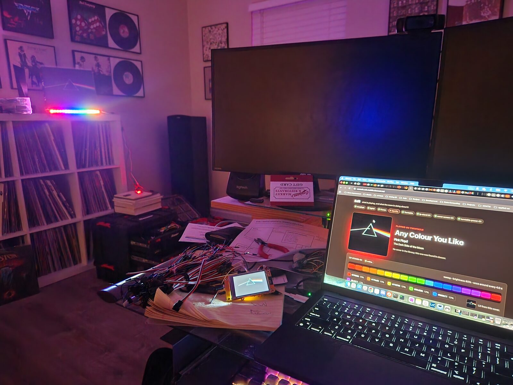

The [LP Jacket Stand](../../maker/lp-jacket-stand/) now lights up in the colors of whatever album is playing. A Raspberry Pi listens to the record, identifies the song, works out which album it's from, pulls the cover art, and sends the colors over MQTT to an ESP32 on the stand. It's working, and I'm still tweaking it. It's also the first piece of EdS, a bigger project that ties the music into the rest of the house.

## The idea

A color display was always the plan. I had the idea of lighting the stand in the album's colors before I built 1.0, and the plain stand was just the first step. The hard part was figuring out which LP is actually on the turntable. My first thought was some kind of camera that would capture the jacket, but I liked the idea of getting song detection, like a smartphone does it, working right here at home. That seemed out of reach at first. It turns out it isn't.

## What I did

The audio was already flowing around the house. My [S/PDIF Audio Distribution](../spdif-audio-distribution/) setup has an analog conversion and distribution stage, the same one that feeds the [FM Transmitter](../fm-transmitter/). I tapped a line-level analog signal off that, ran it into a passive USB capture device, and let a Raspberry Pi sample it.

From there:

- The Pi sends a short sample to Shazam to identify the song. Shazam only knows the song, and its album guess is often a greatest-hits compilation.
- My Discogs collection works out which album the song is from, so the match lands on the record I actually own. Less curated catalogs are the fallback.
- The cover art gets broken down into its dominant colors
- The colors go out over MQTT to an ESP32 on the stand, which drives an addressable RGB strip

Two extras came along for the ride. A web console shows what the system is doing. A small 2" cover art screen shows the sleeve of whatever is playing and can float around the house. It's more novelty than necessity, but it's a fun, inexpensive add-on.

## What surprised me

It mostly just worked. The existing infrastructure enabled this project to be mostly a software effort. The refinements came later, album by album. Pink Floyd's *Dark Side of the Moon* got its own special handling: instead of lifting the top colors from the jacket, it gets a rainbow pattern. Some albums deserve a little more time and effort.

## Result

It's working, and I'm still tweaking it. The Discogs matching helps a lot, but I've only entered about a third of my collection so far, so now I have a real incentive to get the rest in.

## Takeaways

- Reuse the infrastructure you already have
- MQTT keeps the Pi and the ESP32 decoupled, so each side stays simple
- Some albums need hand tuning. No color algorithm was going to come up with the *Dark Side of the Moon* rainbow.
- Single-color covers, especially all black or all white, need special treatment to keep the display interesting

## What's next

Some of the default cover images on Discogs aren't great. Hype stickers show up a lot. A simple way to pin a better image, or a local cache of improved images, is likely next. Song recognition currently depends on an unofficial Shazam API that could stop working at any moment, so a local song fingerprinting solution should be put in place. On the hardware side, the stand's ESP32 controller needs to move off the breadboard and onto a proper circuit board in a mounted enclosure. After that, the stand is just the first of several projects that will tie into the music, covering both control and visuals.

## Links

- [Check out the code](https://github.com/cdeever/eds)
- [Check out the docs](https://cdeever.github.io/eds/)
- [LP Jacket Stand 1.0](../../maker/lp-jacket-stand/)
- [S/PDIF Audio Distribution](../spdif-audio-distribution/)
- [FM Transmitter](../fm-transmitter/)
